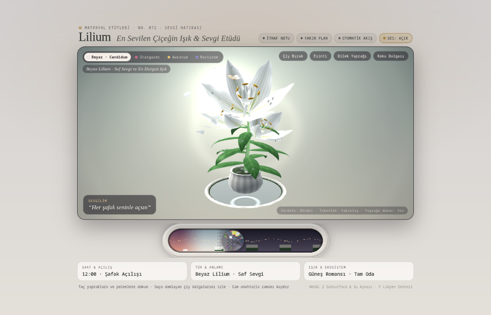

# Lilium — En Sevilen Çiçeğin Işık, Ses & Sevgi Etüdü

> *“Bazı çiçekler zamanla solmaz; sevilen birinin kalbinde her şafak yeniden açar.”*

**Materyal Etütleri · No. 072** — Hiçbir harici varlık (görsel, ses dosyası veya kütüphane) kullanmadan, yalnızca **tek bir HTML dosyası içinde WebGL 2 ve Web Audio API** ile sıfırdan sentezlenmiş etkileşimli **Beyaz *Lilium*** (Zambak) simülasyonu ve hatıra etüdü.

**Canlı Deneyim (GitHub Pages):** https://existye4t.github.io/lilium/

---

## Önizleme

| Gündüz · **Beyaz *Lilium* (`Candidum`)** | Gece · **`Nocturne` Biyolüminesans** |
| :---: | :---: |
|  |  |

---

## Öne Çıkan Özellikler

### Botanik 3B Geometri ve Işıklandırma (WebGL 2)
- **Eklemeli 4 Çiçekli *Lilium* Mimarisi:** Doğal Fibonacci yaprak dizilimi, zarif yivli porselen vazo, yosun dokusu, nehir taşları, 3 açık çiçek ve tepe tomurcuğundan oluşan dinamik 3B ağ yapısı.
- **Yüzey Altı Işık Geçirgenliği (*Subsurface Scattering*):** Porselen beyazı taç yapraklarda arkadan süzülen güneş ve ay ışığı, bal özü olukları, nektar papilleri, polen keseleri ve gün boyu kademeli açılış/kapanış koreografisi.
- **Taş Havuz & Gerçek Zamanlı Su Dalgacıkları:** Su yüzeyine dokunulduğunda veya yaprak/çiy tanesi düştüğünde yayılan eş merkezli kırılma halkaları (`uRipples[6]`).
- **3B Kanat Çırpan Kelebek & Yükselen Hatıra Işıkları:** Gündüzleri çiçekler arasında süzülen 4 kanatlı kırlangıçkuyruk kelebek ve *“Dilek Yaprağı”* bırakıldığında gökyüzüne yükselen sıcak altın-inci ışık küreleri.
- **Bayer 4×4 Dither’lı Şeffaf Cam Zaman Anahtarı:** Alt kısımdaki jel-cam küreyi sürükleyerek 24 saatlik ışık döngüsünü (`00:00` – `24:00`) pürüzsüzce kontrol etme imkânı; küre kırılması, hareket esnemesi ve sönümlü yay salınımıyla birlikte.

### Çeşitler (*Cultivar* Paletleri)
- **Beyaz · *Candidum*** *(Varsayılan)* — Saf sevgi, porselen beyazı taç yapraklar ve adaçayı-inci seracılık atmosferi
- ***Stargazer*** — Kalpten bağlılık, yakut pembe yapraklar ve koyu nektar benekleri
- ***Auratum*** — Altın hatıra, fildişi yapraklar üzerinde altın şerit
- ***Nocturne*** — Ay ışığında parıldayan biyolüminesans damarlar ve yıldızlı gece göğü

### Sentezlenmiş Müzik: *“Beyaz Zambak Noktürnü”* (Web Audio API)
Hiçbir ses dosyası olmadan gerçek zamanlı üretilen **74 BPM, 8 ölçülü (128 adım) F Lidyen** oda müziği süiti ve doğal foley katmanları:
- **Günün Saatine Göre Açılan Orkestrasyon:** Gece *Keçe Piyano*, kontrabas ve cırcır böcekleriyle başlar; şafakta *Konser Arpı*, gün ortasında titreşimli *Şarkı Söyleyen Çello/Keman* melodisi ve hafif kalp atışı nabzıyla zenginleşir; gece tekrar *Çelesta* yıldız çanlarına döner.
- **Mekânsal Derinlik:** Asimetrik *stereo ping-pong* konservatuvar yankısı, 2.85 sn salon konvolüsyon reverb’ü ve güneşe bağlı açılan alçak geçiren filtre.
- **Armonik Dokunuşlar:** Taç yapraklara, anter polenlerine ve su aynasına dokunulduğunda çalan tüm notalar o anki ölçünün akor dizisiyle uyumlu olarak tınlar.

### Kişiselleştirilebilir İthaf Notu & Bağlantı Paylaşımı
- Sağ üstteki **İthaf Notu** düğmesiyle veya sol alttaki plakaya tıklayarak sevdikleriniz için başlık ve mesaj yazabilirsiniz (`localStorage` ile kaydedilir).
- Düzenleyici içindeki **Bağlantıyı Kopyala** düğmesiyle doğrudan kişiye özel bir URL oluşturabilirsiniz:
  - `?kime=<Alıcı>&not=<Mesaj>&tur=<0..3>`
  - Örnek: `https://existye4t.github.io/lilium/?kime=En+De%C4%9Ferlime&not=Her+%C5%9Fafak+seninle+a%C3%A7s%C4%B1n&tur=0`

---

## Etkileşim Rehberi

| Etkileşim | Sonuç |
| :--- | :--- |
| **Cam Anahtarı Sürükle / `←` `→`** | Zamanı (`Gece Çiyi` → `Şafak` → `Güneş` → `Altın Saat` → `Ay`), çiçek açılışını ve müziği yönetir |
| **Taç Yaprağa Dokun** | Yaprağı esnetir; aktif akora uyumlu cam harmonik + arp notası çalar |
| **Polen Kesesine (Anter) Dokun** | Altın polen bulutu saçar ve yıldız çelestası tınlatır |
| **Su Aynasına Tıkla / Sürükle** | Su halkaları oluşturur ve su-marimba damla notaları çalar |
| **Boşluğa Sürükle & Tekerlek** | 3B kamera açısını döndürür ve yakınlaştırır |
| **Dilek Yaprağı / Çiy / Esinti / Koku** | Süzülen 3B taç yapraklar, yükselen hatıra ışıkları, çiy taneleri ve koku dalgaları gönderir |

---

## Kurulum & Yerel Çalıştırma

Proje sıfır bağımlılığa sahiptir; doğrudan herhangi bir statik HTTP sunucusuyla çalıştırılabilir:

```bash
git clone https://github.com/existye4t/lilium.git
cd lilium
python3 -m http.server 8080
```

Ardından tarayıcıdan `http://localhost:8080` adresini açabilirsiniz.

---

## Lisans

Bu proje [MIT Lisansı](LICENSE) altında paylaşılmıştır.
