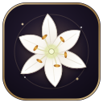
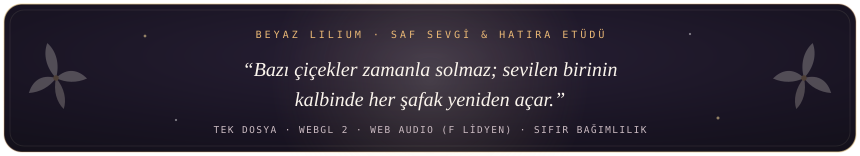
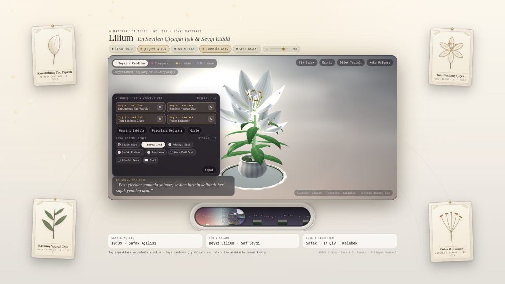
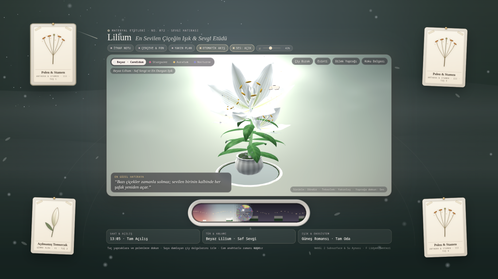
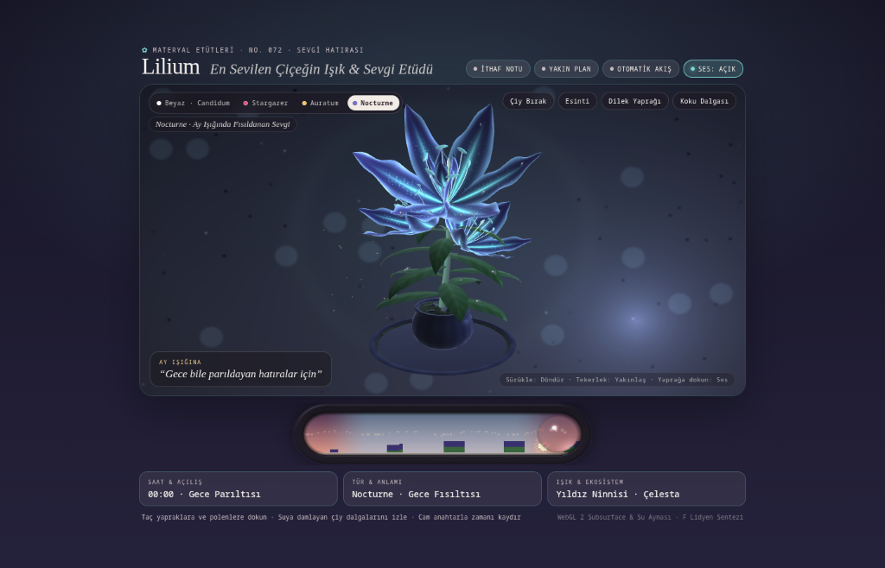
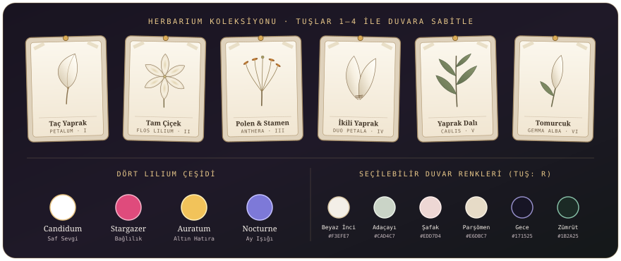

<p align="center">
  <a href="https://existye4t.github.io/lilium/">
    
  </a>
</p>

<h1 align="center">Lilium &mdash; En Sevilen Çiçeğin Işık, Ses &amp; Sevgi Etüdü</h1>

<p align="center">
  <em>Materyal Etütleri &middot; No. 072 &nbsp;&middot;&nbsp; Sevilen Birinin Kalbinde Her Şafak Yeniden Açan Tek Dosyalık Yaşayan Hatıra</em>
</p>

<p align="center">
  <a href="https://existye4t.github.io/lilium/"><strong>&#10047; Canlı Bahçeyi Aç (GitHub Pages) &rarr;</strong></a>
  &nbsp;&nbsp;&middot;&nbsp;&nbsp;
  <a href="#galeri">Galeri</a>
  &nbsp;&nbsp;&middot;&nbsp;&nbsp;
  <a href="#herbarium">Herbarium &amp; Renkler</a>
  &nbsp;&nbsp;&middot;&nbsp;&nbsp;
  <a href="#ses-ve-muzik">Ses &amp; Müzik</a>
  &nbsp;&nbsp;&middot;&nbsp;&nbsp;
  <a href="#rehber">Etkileşim</a>
</p>

<p align="center">
  
</p>

<p align="center">
  
</p>

<a id="galeri"></a>

## &#10047; Sahne &amp; Atmosfer Galerisi

Beyaz *Lilium candidum* için kurgulanmış bu etkileşimli konservatuvar sahnesi, günün saatine göre yaşayan ışık geçişlerini, su aynasını ve duvarlara iğnelenebilen kurutulmuş bitki çerçevelerini bir araya getirir. Hiçbir harici görsel, ses dosyası veya kütüphane kullanmadan, tümüyle **tek bir `index.html` içinde WebGL 2 ve Web Audio API** ile sıfırdan üretilir.

<table>
  <tr>
    <td align="center" width="50%">
      
      <br />
      <strong>Beyaz İnci Atölyesi &amp; Çerçeve Seçici</strong>
      <br />
      <sub>Seçilebilir duvar paletleri, 4 sabitleme yuvası ve ses seviyesi kaydırıcısı</sub>
    </td>
    <td align="center" width="50%">
      
      <br />
      <strong>Zümrüt Sera &amp; Kurutulmuş Çerçeveler</strong>
      <br />
      <sub>Sağ ve sol kenarlara iğnelenen arşiv tipi kurumuş zambak incelemeleri</sub>
    </td>
  </tr>
  <tr>
    <td colspan="2" align="center">
      
      <br />
      <strong>Gece Parıltısı &middot; <code>Nocturne</code> Biyolüminesansı</strong>
      <br />
      <sub>Yıldızlı gökyüzü, ateş böcekleri ve ay ışığında parlayan taç yaprak damarları</sub>
    </td>
  </tr>
</table>

<p align="center">
  
</p>

<a id="herbarium"></a>

## &#127804; Kurutulmuş Herbarium Koleksiyonu &amp; Duvar Paletleri

> *“Sevilen bir çiçeği yalnızca açtığı an değil; kurutulup saklanan her yaprağıyla da hatırada tutabilmek için…”*

Masaüstü görünümünde sahnenin iki yanındaki konservatuvar duvarına **6 farklı kurutulmuş Beyaz *Lilium* çalışmasından** dördünü raptiyeli arşiv çerçeveleriyle sabitleyebilir, `1`–`4` tuşlarıyla yerleştirip kaldırabilir ve arka plan duvarını günün ritmine bırakabilir ya da dilediğiniz renge boyayabilirsiniz.

<p align="center">
  
</p>

<p align="center">
  
</p>

## &#127775; Neler Yaşar Bu Bahçede?

- **Eklemeli 3B *Lilium candidum* &amp; Işık Geçirgenliği (*Subsurface Scattering*):** Yivli porselen vazo, yosun dokusu, nehir taşları, Fibonacci yaprak dizilimi, 3 açık çiçek ve tepe tomurcuğu. Gün ışığı yaprakların arkasından yumuşak porselen parlaklığıyla süzülür.
- **Taş Su Aynası &amp; Çiy Dalgacıkları:** Su yüzeyine her dokunuşunuzda veya bir çiy damlası düştüğünde gerçek zamanlı kırılma halkaları yayılır.
- **Kanat Çırpan Kelebek &amp; Yükselen Hatıra Işıkları:** Gündüzleri çiçeklerin arasında süzülen 3B kırlangıçkuyruk kelebek; *Dilek Yaprağı* gönderdiğinizde göğe doğru yükselen sıcak altın-inci hatıra küreleri ve süzülen taç yapraklar.
- **Kişiselleştirilebilir İthaf Plakası &amp; Sevgi Bağlantısı:** Sol alt plakaya veya **İthaf Notu** düğmesine dokunarak sevdiğinizin adını ve kalbinizden geçen sözü yazabilir; **Bağlantıyı Kopyala** ile ona doğrudan o notla açılan özel bir bağlantı armağan edebilirsiniz (`?kime=...&not=...&tur=...`).
- **Cam Damla Zaman Anahtarı (`04:00` &rarr; `00:00`):** Alttaki cam küre Bayer 4&times;4 *dither* gökyüzünü kırarak büker; sürüklerken esner, durduğunda jel gibi yumuşakça titrer.

<p align="center">
  
</p>

<a id="ses-ve-muzik"></a>

## &#127925; Sentezlenmiş Müzik: *“Beyaz Zambak Noktürnü”*

Hiçbir ses dosyası kullanılmadan, **Web Audio API** ile sıfırdan sentezlenen **74 BPM, 8 ölçülü (128 adım) F Lidyen** oda müziği süiti ve doğal atmosfer:

- **Günün Saatine Göre Açılan Katmanlar:** Gece *Keçe Piyano*, kontrabas, yumuşak akşam esintisi ve cırcır böcekleriyle başlar; şafakta *Konser Arpı*, gün ortasında titreşimli *Şarkı Söyleyen Çello &amp; Keman* ve kalp atışı nabzıyla zenginleşir; ay ışığında *Çelesta* yıldız çanlarına döner.
- **Doğrudan Ses Denetimi:** Üst araç çubuğundaki cam **Ses Kaydırıcısı (`%0–%100`)** ile sesi hassas biçimde ayarlayabilir, `Ses` düğmesiyle tek tıkla kapatıp açabilirsiniz.
- **Akustik Dokunuşlar:** Her taç yaprak esnemesi, altın polen bulutu ve su dalgacığı, çalan o anki ölçünün akoruna göre armonik olarak tınlar.

<p align="center">
  
</p>

<a id="rehber"></a>

## &#129517; Etkileşim &amp; Klavye Rehberi

| Etkileşim / Tuş | Sahnedeki Karşılığı |
| :--- | :--- |
| **Cam Anahtarı Sürükle &middot; `←` `→`** | Saati (`Gece Çiyi` &rarr; `Şafak` &rarr; `Güneş` &rarr; `Altın Saat` &rarr; `Ay`), çiçek açılışını ve orkestrasyonu yönetir |
| **Ses Kaydırıcısı &middot; `Ses` Düğmesi** | Genel müzik ve atmosfer düzeyini `%0–%100` arasında ayarlar (tercih tarayıcıda saklanır) |
| **`1` – `4` Tuşları &middot; `Shift + 1..4`** | Kenarlardaki 4 kurutulmuş *Lilium* çerçevesini duvara sabitler / gizler (`Shift` ile parçayı değiştirir) |
| **Çerçeveye Tıkla &middot; `Çerçeve &amp; Fon`** | Duvara asılı parçayı sıradaki kuru zambak incelemesiyle değiştirir veya atölye panelini açar |
| **`R` Tuşu &middot; Renk Paleti / `Özel`** | Arka planı *Saate Göre*, *Beyaz İnci*, *Adaçayı Sisi*, *Şafak Pudrası*, *Parşömen*, *Gece Kadifesi* veya *Zümrüt Sera* arasında çevirir |
| **Taç Yaprak / Polen / Su Aynası** | Yaprağı büker, polen saçar, su dalgası oluşturur ve o anki akora uyumlu notalar çalar |
| **Boşluğa Sürükle &middot; Tekerlek** | 3B kamera açısını serbestçe döndürür ve yakınlaştırır |
| **İthaf Plakası &middot; `Dilek Yaprağı`** | Sevgi mesajını düzenler, URL olarak paylaşır ve yükselen altın hatıra ışıkları bırakır |
| **Özel İthaf URL Parametreleri** | `?kime=Ad&amp;not=Mesaj&amp;tur=0..3` şeklinde doğrudan kişiye özel açılış bağlantısı oluşturur |

<details>
<summary><strong>Teknik Mimari &amp; Yerel Çalıştırma</strong></summary>

<br />

- **Tek Dosya Mimari:** Bütün WebGL 2 shader’ları (`PBR` benzeri yaprak *subsurface scattering*, yansıtmalı su havuzu, parçacık sistemi, 2B ortam kanvası ve Bayer 4&times;4 cam zaman anahtarı) tek [`index.html`](index.html) dosyasındadır. Tarayıcı ikonu (`favicon`) hem veri-URI vektör olarak gömülüdür hem de [`assets/lilium-icon.svg`](assets/lilium-icon.svg) ve [`assets/lilium-icon.png`](assets/lilium-icon.png) dosyalarıyla sunulur.
- **Saklanan Tercihler (`localStorage`):** İthaf notu (`lilium_dedication_v1`), ses düzeyi (`lilium_vol_v1`), sabitlenmiş herbarium çerçeveleri (`lilium_frames_v1`) ve seçili arka plan rengi (`lilium_bg_v1`) oturumlar arasında korunur.

```bash
git clone https://github.com/existye4t/lilium.git
cd lilium
python3 -m http.server 8080
# Tarayıcıdan http://localhost:8080 adresini açın
```

</details>

<p align="center">
  
</p>

<p align="center">
  <sub>Beyaz bir <em>Lilium</em> hatırasına &middot; <a href="LICENSE">MIT Lisansı</a></sub>
</p>
